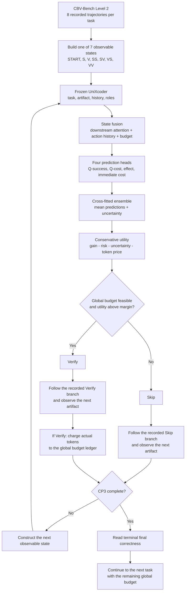

# DARC v0.5 — Model and Offline-RL Flow

This document describes the architecture, data representation, target construction,
training objectives, decision policy, and budget accounting used by **DARC v0.5 —
Conservative Budget-Aware Offline RL**.

## 1. Problem definition

The workflow contains three fixed checkpoints:

```text
CP1 Planner → CP2 Coder → CP3 Reviewer → Final correctness
       S/V          S/V          S/V
```

At each checkpoint, the controller chooses one of two actions:

- `S` — Skip Teacher verification.
- `V` — invoke the Teacher to verify and potentially revise the current artifact.

The objective is to maximize final correctness under a global Teacher-token budget:

$$
\max_\pi \; \mathbb{E}[Y_{final}]
\quad\text{subject to}\quad
\sum c_{teacher} \le B_{global}.
$$

DARC v0.5 is a **finite-horizon offline-RL controller**, not an online PPO or DQN
system. Training does not invoke the Student or Teacher again. Instead, the model
learns from counterfactual trajectories already collected in CBV-Bench Level 2.

Each complete Level-2 task contains all eight trajectories:

```text
SSS, SSV, SVS, SVV, VSS, VSV, VVS, VVV
```

### 1.1. Main flow at a glance

The complete system has four stages:

```text
Recorded Level-2 branches
        ↓
Observable state representation
        ↓
Q-success, Q-cost, effect-risk, and immediate-cost prediction
        ↓
Budget-feasible conservative Verify/Skip decisions
```



The corresponding training flow is:

```text
For each observable state and budget allowance
        ↓
Force action S and replay one continuation policy
Force action V and replay the same continuation policy
        ↓
Read terminal correctness and cumulative Teacher cost
        ↓
Construct Q-success, Q-cost, effect, and immediate-cost targets
        ↓
Train cross-fitted ensemble members
        ↓
Tune the conservative decision rule on validation only
```

The most important separation is that recorded future outcomes and costs may be
used to construct offline training targets, but they are not exposed to the policy
as inference-time inputs.

## 2. State tree and branch consistency

Three binary decisions produce seven non-terminal decision states:

```text
CP1: START
CP2: S, V
CP3: SS, SV, VS, VV
```

The number of decision states is:

$$
1 + 2 + 4 = 7.
$$

The eight trajectories are the eight terminal leaves after CP3. Decision states
and terminal trajectories are different concepts.

```text
                              START
                         / S           \ V
                       S                 V
                   / S   \ V         / S   \ V
                  SS      SV         VS      VV
                 / \     / \        / \     / \
              SSS SSV SVS SVV    VSS VSV VVS VVV
```

Transitions are branch-consistent. For example:

```text
State V  + action S → state VS
State V  + action V → state VV
State SV + action V → terminal SVV
```

The artifact at the next state must come from the same observed prefix. The
controller cannot use an artifact, outcome, or realized cost from another future
branch.

## 3. MDP formulation

### 3.1. Observable state

At checkpoint $t$, the model receives only information available at decision time:

$$
s_t=(x_{task},x_{artifact},x_{history},r_t,d_t,h_t,A_t).
$$

The terms are:

- $x_{task}$: task or problem description.
- $x_{artifact}$: current intermediate artifact.
- $x_{history}$: previously observed artifacts and decisions.
- $r_t$: current agent role.
- $d_t$: downstream roles and dependencies.
- $h_t$: action prefix, such as `S`, `V`, `SV`, or `VV`.
- $A_t$: current per-task allowance.

Future artifacts, final outcomes, realized future costs, and oracle-best descendants
are not inference features.

### 3.2. Action

$$
a_t\in\{S,V\}.
$$

### 3.3. Terminal outcome and cost

Final correctness is binary:

$$
Y_T\in\{0,1\}.
$$

Cumulative Teacher cost from the current state is:

$$
C_T=\sum_{k=t}^{T}c_k.
$$

There is no intermediate correctness reward. The primary correctness signal is
observed only at the terminal state. Because the workflow has only three steps,
the implicit discount factor is $\gamma=1$.

## 4. Input representation

### 4.1. Frozen semantic encoder

DARC uses frozen `microsoft/unixcoder-base` embeddings for:

1. The task or problem.
2. The current artifact.
3. The observable workflow history.
4. The current agent role.
5. Downstream role and dependency descriptions.

Long text is chunked with `max_length=512`, stride 480, and at most five chunks.
Embeddings are cached so they do not need to be recomputed for every seed or epoch.

Each of the four primary segments is projected to hidden dimension 128:

$$
z_i=\operatorname{GELU}(\operatorname{LayerNorm}(W_i e_i+b_i)).
$$

The projected segments are concatenated with standardized metadata:

$$
z_{state}=\operatorname{Fusion}
([z_{task};z_{artifact};z_{history};z_{role};m]).
$$

### 4.2. Downstream attention

The current state is used as the query, while downstream dependencies provide the
keys and values:

$$
c=\operatorname{MHA}
(Q=z_{state},K=z_{downstream},V=z_{downstream}).
$$

A learned gate controls how much downstream context enters the representation:

$$
g=\sigma(W_g[z_{state};c]+b_g),
$$

$$
z_{semantic}=\operatorname{Trunk}
(\operatorname{LayerNorm}(z_{state}+g\odot c)).
$$

The purpose is to represent the current artifact in relation to the downstream
agents that will consume it later in the workflow.

### 4.3. Action-history encoding

The two previous actions are represented using learned embeddings:

```text
Padding = 0
Skip    = 1
Verify  = 2
```

Examples:

| Prefix | Tokens |
|---|---|
| `START` | `[0, 0]` |
| `S` | `[1, 0]` |
| `V` | `[2, 0]` |
| `SV` | `[1, 2]` |
| `VV` | `[2, 2]` |

The two embeddings are flattened and projected to a 64-dimensional vector.

### 4.4. Budget encoding

The per-task allowance $A$ is represented by three features:

$$
b_1=\frac{A}{B_{ref}},
$$

$$
b_2=\frac{\log(1+A)}{\log(1+B_{ref})},
$$

$$
b_3=\operatorname{clip}\left(\frac{A}{B_{ref}},0,2\right).
$$

These features are projected to a 64-dimensional vector.

### 4.5. Joint representation

```text
Semantic state  → 64
Action history  → 64
Budget state    → 64
                    ↓
Concatenate     → 192
Joint MLP       → 128 → 64
```

Formally:

$$
h=\operatorname{Joint}
([z_{semantic};z_{action};z_{budget}]).
$$

## 5. Output heads

The shared representation $h$ is passed to four output heads.

### 5.1. Q-success head

The head produces two logits:

$$
Q_y(s,S),\;Q_y(s,V).
$$

After a sigmoid transformation:

$$
Q_y(s,a)\approx
P(Y_T=1\mid s_t=s,a_t=a,\pi_{continuation}).
$$

It estimates the probability of a correct final solution after taking Skip or
Verify and following the specified continuation policy.

### 5.2. Q-cost head

The head produces:

$$
Q_c(s,S),\;Q_c(s,V),
$$

where:

$$
Q_c(s,a)\approx
\mathbb{E}\left[\sum_{k=t}^{T}c_k
\mid s_t=s,a_t=a,\pi_{continuation}\right].
$$

This is cumulative downstream cost, not only the current call cost. Cost is learned
in `log1p` space and converted back with `expm1` during inference.

### 5.3. Effect head

The three-class effect head predicts:

```text
Harmful / No-change / Helpful
```

The label compares forced Verify and forced Skip under the same continuation:

$$
\Delta Y=Y_V-Y_S.
$$

- $\Delta Y=-1$: Harmful.
- $\Delta Y=0$: No-change.
- $\Delta Y=+1$: Helpful.

### 5.4. Immediate-cost head

The final head predicts the cost of a Teacher call at the current state:

$$
\hat c_{immediate}(s).
$$

This prediction is used by the hard action-feasibility gate.

## 6. Q-target generation

DARC v0.5 does not maximize over all future descendant trajectories. For every
state, allowance, and forced action, the pipeline follows exactly one continuation
policy:

```text
Force S or V
     ↓
Follow a fixed observable continuation policy
     ↓
Reach the recorded terminal trajectory
     ↓
Read final correctness and cumulative actual tokens
```

The targets are terminal Monte Carlo returns:

$$
\hat Q_y^\pi(s,a)=Y_T(s,a,\pi),
$$

$$
\hat Q_c^\pi(s,a)=\sum_{k=t}^{T}c_k(s,a,\pi).
$$

### 6.1. Myopic targets

After the forced action, all future checkpoints are forced to Skip:

```text
Forced action → S → S → terminal
```

Examples:

| State | Skip target | Verify target |
|---|---|---|
| `START` | `SSS` | `VSS` |
| `S` | `SSS` | `SVS` |
| `V` | `VSS` | `VVS` |
| `SV` | `SVS` | `SVV` |
| `VV` | `VVS` | `VVV` |

A myopic target does not restrict inference to one Verify. The controller is
queried again at every next state. For example:

```text
START chooses V → state V chooses V → state VV chooses S → VVS
```

### 6.2. Policy-aware targets

After the forced action, the controller follows the current continuation policy:

```text
Forced action → current policy → terminal
```

If `V` is forced at `START`, the continuation may produce `VSS`, `VSV`, `VVS`, or
`VVV`. Only the trajectory selected by the policy is used. The pipeline does not
invoke an oracle to choose the best future descendant.

## 7. Offline policy iteration

### 7.1. Iteration 0

For policy-aware variants, the initial continuation policy comes from DARC v0.4:

$$
\pi_0=\pi_{DARC-v0.4}.
$$

The pipeline constructs targets for $Q^{\pi_0}$, trains DARC v0.5, and tunes the
conservative decision policy.

For `myopic_targets`, continuation always chooses Skip, so target construction does
not depend on the DARC v0.4 policy.

### 7.2. Iteration 1

A new policy is derived from the iteration-0 model:

$$
\pi_1=\operatorname{GreedyConservative}(Q^{\pi_0}).
$$

Targets are regenerated as:

$$
\hat Q^{\pi_1}(s,a)=\operatorname{Rollout}(s,a,\pi_1),
$$

and an iteration-1 model is trained. This is fitted policy evaluation followed by
policy improvement.

### 7.3. Cross-fitting

Training tasks are assigned to three folds. Each Q-model member excludes one fold
from training. When continuation targets are generated for the next iteration, a
task uses predictions from a model that did not train on that task's fold. This
reduces self-target leakage.

## 8. Training objectives

### 8.1. Q-success loss

$$
\mathcal L_{success}
=\frac{1}{|\mathcal M|}
\sum_{(i,a)\in\mathcal M}
\operatorname{BCEWithLogits}(\hat q_{i,a},y_{i,a}).
$$

The action mask $\mathcal M$ excludes invalid Verify targets at zero allowance.

### 8.2. Cumulative-cost loss

The target is normalized in log space:

$$
\tilde C=\frac{\log(1+C)-\mu_C}{\sigma_C},
$$

and optimized with Smooth-L1:

$$
\mathcal L_{cost}=\operatorname{SmoothL1}(\hat C,\tilde C).
$$

### 8.3. Immediate-cost loss

$$
\mathcal L_{immediate}
=\operatorname{SmoothL1}(\hat c_{immediate},\tilde c_{immediate}).
$$

### 8.4. Class-balanced focal effect loss

Because No-change is the dominant effect class:

$$
\mathcal L_{effect}=w_y(1-p_y)^\gamma[-\log p_y],
$$

with `focal_gamma = 2.0` and effective class weights using `beta = 0.999`.

### 8.5. Total loss

$$
\boxed{
\mathcal L
=1.0\mathcal L_{success}
+0.35\mathcal L_{cost}
+0.15\mathcal L_{immediate}
+0.25\mathcal L_{effect}
}
$$

Primary optimization settings:

- AdamW optimizer.
- Learning rate `7e-4`.
- Weight decay `1e-4`.
- Gradient clipping at `5.0`.
- At most 60 epochs.
- Early-stopping patience of 10 epochs.

Checkpoint selection uses:

$$
\mathcal L_{val-select}
=\mathcal L_{val-success}+0.35\mathcal L_{val-cost}.
$$

## 9. Ensemble prediction and uncertainty

For ensemble members $m=1,\ldots,M$, the member-level advantage is:

$$
A^{(m)}(s)=Q_y^{(m)}(s,V)-Q_y^{(m)}(s,S).
$$

The ensemble mean and uncertainty are:

$$
\bar A(s)=\frac{1}{M}\sum_m A^{(m)}(s),
$$

$$
\sigma_A(s)=\operatorname{Std}_m[A^{(m)}(s)].
$$

The member-level additional cumulative cost is:

$$
\Delta C^{(m)}
=\max(Q_c^{(m)}(s,V)-Q_c^{(m)}(s,S),0).
$$

The model computes corresponding means and standard deviations for additional cost
and immediate call cost.

## 10. Conservative decision policy

The lower-confidence advantage is:

$$
A_{lower}=\bar A-\beta_A\sigma_A.
$$

The upper-confidence additional cost is:

$$
C_{upper}=\bar{\Delta C}+\beta_C\sigma_C.
$$

Dynamic budget pressure is:

$$
P(A)=\left(\frac{B_{ref}}{\max(A,1)}\right)^\eta,
$$

which produces the dynamic token price:

$$
\lambda(A)=\lambda_0P(A).
$$

The final decision utility is:

$$
\boxed{
U(s)
=A_{lower}
-w_H P(Harmful\mid s)
-\lambda(A)\frac{C_{upper}}{B_{ref}}
}
$$

The policy selects Verify when:

$$
U(s)>m
$$

and the action passes the hard feasibility gate. Here, $m$ is a
validation-tuned decision margin.

## 11. Budget semantics

Three budget quantities must be kept separate.

### 11.1. Global remaining budget

$$
B_{remaining}=B_{initial}-\text{actual tokens already spent}.
$$

This is the strict actual-token ledger shared by the complete replay.

### 11.2. Per-task allowance

$$
A_i=\frac{B_{remaining}}{\text{number of unprocessed tasks}}.
$$

The allowance is an observable shadow allocation used for budget conditioning and
dynamic token pricing. It is not a hard cap for an individual task.

### 11.3. Hard-call reserve

A Verify action is admitted only when:

$$
B_{remaining}\ge8192
$$

and:

$$
\hat c_{immediate}+\sigma_{immediate}\le B_{remaining}.
$$

Only after the action has been fixed is its recorded actual cost revealed and
deducted from the global ledger. Realized future cost is never used to choose the
online action.

### 11.4. Corrected budget-state bug

The training allowances are:

```text
[0, 1228, 2456, 3684, 4912]
```

The original bug directly compared these allowances with the 8192-token hard-call
reserve, incorrectly masking every Verify target. The corrected semantics are:

- Allowance is only an allocation feature and shadow price.
- The hard reserve is compared only with the global budget.
- Every positive allowance receives forced-Verify supervision.
- Only zero allowance masks the Verify target.

During positive-allowance target construction, the environment receives enough
synthetic global capacity for every remaining call. This applies only to target
construction; inference still uses the strict global actual-token ledger.

## 12. End-to-end inference flow

```text
Initialize global Teacher-token budget
                 │
                 ▼
Deterministically order tasks by seed
                 │
                 ▼
allowance = remaining budget / remaining tasks
                 │
                 ▼
Build the observable state at CP1
                 │
                 ▼
Frozen UniXcoder + state/history/budget fusion
                 │
                 ▼
Predict Q-success, Q-cost, effect risk, and immediate cost
                 │
                 ▼
Aggregate ensemble means and uncertainties
                 │
                 ▼
Compute conservative decision utility
                 │
        ┌────────┴────────┐
        │                 │
        S                 V
        │        Check strict global feasibility
        │                 │
        └────────┬────────┘
                 ▼
Follow the exact recorded branch and observe the next artifact
                 │
          If V, charge actual tokens
                 │
                 ▼
Repeat at CP2 and CP3
                 │
                 ▼
Read terminal final correctness
                 │
                 ▼
Continue to the next task with the remaining global budget
```

## 13. Model selection and current empirical status

The original v0.5 experiment used 381 Level-2 training tasks and 98 validation
tasks. The later scaling experiment retained the same Myopic iteration-0 algorithm
and expanded training to 531 tasks while leaving validation unchanged.

The current development candidate is:

```text
DARC v0.5 Myopic Targets — Iteration 0
```

Original validation comparison:

| Policy | Accuracy | Actual tokens | Calls |
|---|---:|---:|---:|
| DARC v0.5 Myopic i0 | 52.04% | 186,867 | 116.3 |
| C3 MultiHistory Continuation | 52.04% | 345,349 | 206.0 |
| C3 MultiHistory Myopic | 52.04% | 357,291 | 211.0 |
| Never Verify | 46.94% | 0 | 0 |

The appropriate interpretation is:

- DARC currently shows its clearest benefit in **token efficiency**.
- DARC does not yet provide a raw-accuracy win over C3 on this validation set.
- Iteration 1 did not improve over iteration 0.
- Approximately 95% of selected Verify calls remain No-change interventions.
- Seed instability remains substantial: different seeds can obtain the same
  accuracy while spending very different token amounts.
- Because validation contains only 98 tasks and is also used for model and policy
  selection, these results do not establish confirmatory superiority.

## 14. Key takeaways

1. DARC v0.5 learns over **seven observable decision states**; it does not treat the
   eight trajectories as eight independent states.
2. `Myopic` describes target construction. It does not prevent the policy from
   verifying at multiple checkpoints during inference.
3. Q-success and Q-cost are learned separately; the policy later scalarizes gain,
   risk, uncertainty, and cost.
4. Per-task allowance is a shadow allocation; global remaining budget is the hard
   ledger.
5. Offline outcomes and costs construct training targets but are never exposed as
   online decision features.
6. The current best candidate is Myopic iteration 0. Learned continuation and
   policy improvement have not yet demonstrated a measurable benefit.

## 15. Source map

- `src/agent_verify/analysis/darc_v05_model.py`: neural architecture, output heads,
  ensemble prediction, and uncertainty.
- `src/agent_verify/analysis/darc_v05_training.py`: target construction, losses,
  cross-fitting, training, and conservative policy score.
- `src/agent_verify/analysis/darc_v05_env.py`: branch-consistent offline replay and
  strict budget accounting.
- `src/agent_verify/analysis/darc_v05_experiment.py`: policy iteration, policy-grid
  tuning, evaluation, and artifact generation.
- `configs/darc_v05_offline_rl.yaml`: seeds, architecture parameters, loss weights,
  policy grid, and budget configuration.
- `src/final_report_241026.md`, Section 30: results, figures, diagnostics, and current
  conclusions.
